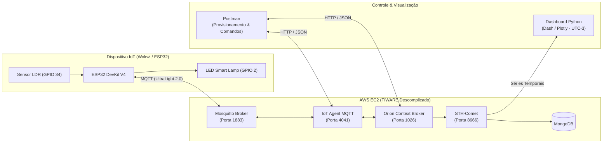

<div align="center">


<br>


<br>

**Controle remoto de iluminação e monitoramento de luminosidade em tempo real**

Turma 1ESPG · FIAP · Prof. Fábio Henrique Cabrini

</div>

---

## 📌 Sobre o Projeto

Projeto desenvolvido para o **Checkpoint 4 (CP4)** da disciplina de **Edge Computing & Computer Systems**, baseado na arquitetura **FIWARE Descomplicado**.

A solução integra um microcontrolador **ESP32** (equipado com um sensor fotoresistor **LDR** e um atuador **LED**) a uma máquina virtual na nuvem (**AWS EC2**) rodando os contêineres do ecossistema **FIWARE**. O sistema permite:
- **Telemetria em tempo real:** Leitura contínua da luminosidade ambiente enviada a cada 2 segundos via protocolo **MQTT (UltraLight 2.0)**.
- **Comando e Controle remoto:** Acionamento da lâmpada (`on` / `off`) via **Orion Context Broker** com confirmação imediata de execução (`cmdexe`).
- **Histórico e Visualização (Séries Temporais):** Armazenamento de leituras no **STH-Comet / MongoDB** e exibição gráfica em tempo real via **Python (Dash & Plotly)** e **Postman**.

---

## 👥 Integrantes do Grupo

<div align="center">

| Nome Completo | RM | Turma |
| :--- | :---: | :---: |
| **Ian Tassiotto** | RM570812 | 1ESPG |
| **Hyan Hideo** | RM571005 | 1ESPG |
| **João Gabriel** | RM573685 | 1ESPG |
| **Elizeu Queiroz** | RM569433 | 1ESPG |
| **Guilherme Caiano** | RM570491 | 1ESPG |

</div>

---

## 🏗️ Arquitetura da Solução (Edge to Cloud)

A instância **AWS EC2** atua como o *Back-end* central e ponte intermediária do sistema: ela recebe os pacotes leves em **MQTT** vindos do ESP32, traduz para o padrão **HTTP/NGSI-v2** através do **IoT Agent** e persiste tanto o estado atual quanto o histórico temporal.



### Componentes e Portas na AWS EC2

| Serviço / Contêiner | Porta (TCP) | Papel na Arquitetura |
| :--- | :---: | :--- |
| **Eclipse Mosquitto** | `1883` | Broker MQTT responsável por receber a telemetria do ESP32 e entregar comandos `on`/`off`. |
| **IoT Agent (UltraLight)** | `4041` | Traduz mensagens curtas do protocolo MQTT (`s\|on`, `76`) para entidades NGSI no Orion. |
| **Orion Context Broker** | `1026` | Gerencia o **estado atual** da lâmpada (`state` e `luminosity`) e encaminha comandos. |
| **STH-Comet** | `8666` | Armazena o **histórico de variações** (*Short-Term History*) no MongoDB para geração de gráficos. |

---

## 🔌 Esquema Elétrico e Pinagem (ESP32)

| Componente | Pino no Componente | Pino no ESP32 | Descrição Técnica |
| :--- | :---: | :---: | :--- |
| **LED Azul (Smart Lamp)** | Ânodo (`A` / `+`) | `GPIO 2` (c/ Resistor 220Ω) | Entrada positiva de acionamento (`HIGH` = aceso / `LOW` = apagado) |
| **LED Azul (Smart Lamp)** | Cátodo (`C` / `-`) | `GND` | Retorno de terra |
| **Módulo Sensor LDR** | `VCC` / `GND` | `3V3` / `GND` | Alimentação elétrica do módulo sensor |
| **Módulo Sensor LDR** | `AO` (Saída Analógica) | `GPIO 34` | Leitura ADC de 12 bits (`0` a `4095` mapeada para `100%` a `0%`) |

---

## 📡 Tópicos MQTT e Protocolo UltraLight 2.0

* **API Key do Service Group:** `4jggokgpepnvsb2uv4s40d59ov`
* **Recurso Raiz:** `/TEF`

| Tópico MQTT | Direção | Payload Exemplo | Função |
| :--- | :---: | :---: | :--- |
| `/TEF/lamp200/attrs` | ESP32 $\rightarrow$ Broker | `s\|on` ou `s\|off` | Publica o estado atual do LED periodicamente (loop não bloqueante via `millis()`). |
| `/TEF/lamp200/attrs/l` | ESP32 $\rightarrow$ Broker | `76` | Publica o nível percentual de luminosidade lido pelo LDR. |
| `/TEF/lamp200/cmd` | Broker $\rightarrow$ ESP32 | `lamp200@on\|` | Tópico assinado pelo ESP32 para receber ordens de acionamento. |
| `/TEF/lamp200/cmdexe` | ESP32 $\rightarrow$ Broker | `lamp200@on\|ok` | Confirma a execução do comando para atualizar o status no Orion. |

> [!NOTE]
> Caso o ambiente do Postman esteja configurado com o ID padrão `lamp001` (`urn:ngsi-ld:Lamp:001`), basta alterar a constante `topicPrefix` e os tópicos no arquivo `sketch.ino` para `lamp001`.

---

## 🚀 Passo a Passo de Execução

### 1. Configuração e Provisionamento (Postman)
Com a instância **AWS EC2** iniciada e as portas `1883`, `4041`, `1026` e `8666` liberadas no *Security Group*:
1. **Service Group (`POST :4041/iot/services`):** Registra o recurso `/TEF` e vincula a `apikey` ao Orion (`:1026`).
2. **Provisionamento da Lâmpada (`POST :4041/iot/devices`):** Cadastra a entidade `Lamp` com os atributos `s` (`state`), `l` (`luminosity`) e os comandos `on` / `off`.
3. **Registro de Comandos (`POST :1026/v2/registrations`):** Conecta o Orion ao IoT Agent para disparo dos comandos remotos.
4. **Assinatura do Histórico (`POST :1026/v2/subscriptions`):** Configura o Orion para notificar o **STH-Comet** (`:8666/notify`) a cada mudança de luminosidade.

### 2. Simulação do Hardware (Wokwi / Arduino IDE)
1. Copie os arquivos da pasta [`esp32-wokwi/`](./esp32-wokwi) (`sketch.ino` e `diagram.json`) para o seu projeto no **Wokwi**.
2. Verifique se `default_BROKER_MQTT` contém o IP público atual da sua VM na AWS.
3. Inicie a simulação, clique sobre o módulo **LDR** para variar a luz ambiente e envie requisições `PATCH` pelo Postman para acender e apagar o LED.

### 3. Visualização Gráfica em Tempo Real (Python Dash)
Como os servidores em nuvem registram *timestamps* no padrão universal **UTC**, o nosso dashboard em Python converte automaticamente os horários recebidos do STH-Comet para o fuso de **Brasília (`UTC-3`)**:

```bash
# Acesse a pasta do dashboard
cd dashboard

# Instale as bibliotecas necessárias
pip install -r requirements.txt

# Inicie o servidor do gráfico
python app.py
```
Em seguida, abra **`http://127.0.0.1:8050`** no navegador para acompanhar a variação da luminosidade ao vivo.

---

## 📂 Estrutura de Arquivos

```text
├── esp32-wokwi/
│   ├── sketch.ino          # Código C++ do ESP32 (MQTT, LDR, LED e confirmação cmdexe)
│   ├── diagram.json        # Circuito completo e pinagem configurada para o Wokwi
│   └── libraries.txt       # Biblioteca PubSubClient para o simulador
├── dashboard/
│   ├── app.py              # Dashboard interativo em Dash/Plotly com ajuste de fuso (UTC-3)
│   └── requirements.txt    # Dependências Python (dash, plotly, requests)
└── README.md               # Documentação completa do projeto
```

---

<div align="center">
  <sub>Desenvolvido para o Checkpoint 4 — Engenharia de Software (1ESPG) · FIAP</sub>
</div>