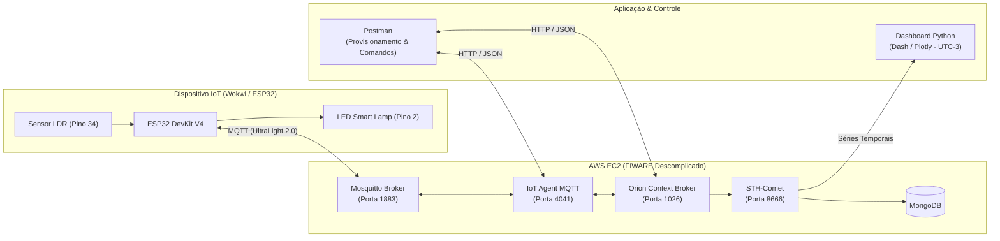

# 💡 Smart Lamp IoT — Integração ESP32 & FIWARE na AWS


Projeto desenvolvido para o **Checkpoint 4 (CP4)** da disciplina de **Edge Computing & Computer Systems** (**1ESPG - FIAP**), baseado na arquitetura **FIWARE Descomplicado** do Prof. Fábio Henrique Cabrini.

O sistema realiza o monitoramento contínuo de luminosidade (via sensor **LDR**) e o acionamento remoto de uma lâmpada inteligente (**LED**) embarcada em um **ESP32**, utilizando o protocolo **MQTT (UltraLight 2.0)** integrado a uma instância **AWS EC2** rodando os microsserviços do ecossistema **FIWARE** e um dashboard em tempo real em **Python (Dash/Plotly)**.

---

## 👥 Integrantes do Grupo (Turma 1ESPG)

| Nome Completo | RM |
| :--- | :--- |
| **Ian Tassiotto** | RM570812 |
| **Hyan Hideo** | RM571005 |
| **João Gabriel** | RM573685 |
| **Elizeu Queiroz** | RM569433 |
| **Guilherme Caiano** | RM570491 |

---

## 🏗️ Arquitetura da Solução

A máquina virtual (**AWS EC2**) atua como o *Back-end* central e middleware da solução, traduzindo protocolos (`MQTT` $\leftrightarrow$ `HTTP/NGSI-v2`) e persistindo tanto o estado atual quanto a série temporal para visualização gráfica.



### Portas e Componentes Utilizados na AWS

| Componente | Porta (TCP) | Função no Projeto |
| :--- | :---: | :--- |
| **Eclipse Mosquitto** | `1883` | Broker MQTT responsável por receber leituras do ESP32 e entregar comandos `on`/`off`. |
| **IoT Agent (UltraLight)** | `4041` | Traduz mensagens curtas do protocolo MQTT (`s\|on`, `l\|76`) para entidades NGSI no Orion. |
| **Orion Context Broker** | `1026` | Gerencia o **estado atual** da lâmpada (`state` e `luminosity`) e roteia comandos. |
| **STH-Comet** | `8666` | Armazena o **histórico temporal** (*Short-Term History*) das variações de luminosidade no MongoDB. |

---

## 🔌 Hardware e Pinagem (ESP32 / Wokwi)

| Componente | Pino noComponente | Pino no ESP32 | Função |
| :--- | :---: | :---: | :--- |
| **LED Azul (Smart Lamp)** | Ânodo (`A` / `+`) | `GPIO 2` (via Resistor 220Ω) | Acionamento da lâmpada (`HIGH` / `LOW`) |
| **LED Azul (Smart Lamp)** | Cátodo (`C` / `-`) | `GND` | Terra |
| **Módulo Sensor LDR** | `VCC` / `GND` | `3V3` / `GND` | Alimentação do sensor |
| **Módulo Sensor LDR** | `AO` (Saída Analógica) | `GPIO 34` | Leitura analógica de luminosidade (`0` a `4095` $\rightarrow$ `0%` a `100%`) |

---

## 📡 Tópicos MQTT e Payloads (UltraLight 2.0)

* **API Key do Service Group:** `4jggokgpepnvsb2uv4s40d59ov`
* **Recurso Raiz:** `/TEF`

| Tópico MQTT | Direção | Exemplo de Payload | Descrição |
| :--- | :---: | :---: | :--- |
| `/TEF/lamp200/attrs` | ESP32 $\rightarrow$ Broker | `s\|on` ou `s\|off` | Publica o estado atual do LED a cada 2s (não bloqueante com `millis()`). |
| `/TEF/lamp200/attrs/l` | ESP32 $\rightarrow$ Broker | `76` | Publica a porcentagem de luminosidade mapeada pelo LDR. |
| `/TEF/lamp200/cmd` | Broker $\rightarrow$ ESP32 | `lamp200@on\|` | Recebe comandos de acionamento disparados via Orion Context Broker. |
| `/TEF/lamp200/cmdexe` | ESP32 $\rightarrow$ Broker | `lamp200@on\|ok` | Confirma a execução do comando para evitar status `PENDING` no Orion. |

*(Nota: Caso a coleção do Postman esteja provisionada com o ID padrão de aula `lamp001` / `urn:ngsi-ld:Lamp:001`, basta ajustar a constante `topicPrefix` no código do ESP32).*

---

## 🚀 Como Executar o Projeto

### 1. Provisionamento no Postman
Com os contêineres Docker ativos na instância EC2 da AWS, execute na sequência:
1. **`POST /iot/services` (Porta `4041`):** Cria o Service Group `/TEF` com a `apikey` padrão.
2. **`POST /iot/devices` (Porta `4041`):** Provisiona a Smart Lamp com os atributos `s` (`state`), `l` (`luminosity`) e os comandos `on` e `off`.
3. **`POST /v2/registrations` (Porta `1026`):** Registra o IoT Agent como provedor dos comandos `on` e `off` no Orion.
4. **`POST /v2/subscriptions` (Porta `1026`):** Inscreve o **STH-Comet** (`http://{{url}}:8666/notify`) para gravar toda alteração do atributo `luminosity`.

### 2. Simulação no Wokwi (ou Upload no ESP32 Físico)
1. Abra a pasta [`esp32-wokwi/`](./esp32-wokwi) e copie o conteúdo de `sketch.ino` e `diagram.json` para o simulador **Wokwi**.
2. Certifique-se de que a constante `default_BROKER_MQTT` aponta para o IP público da instância EC2.
3. Inicie a simulação, altere a incidência de luz clicando sobre o sensor LDR e envie comandos `PATCH` pelo Postman para ligar e desligar o LED em tempo real.

### 3. Dashboard Histórico em Tempo Real (Python)
O servidor na AWS armazena os *timestamps* no padrão universal **UTC**. O nosso script em Python realiza automaticamente a conversão para o fuso horário de **Brasília (`UTC-3`)**:

```bash
# Entre na pasta do dashboard
cd dashboard

# Instale as dependências
pip install -r requirements.txt

# Execute o servidor web do gráfico
python app.py
```
Acesse **`http://127.0.0.1:8050`** no navegador para visualizar a curva de luminosidade atualizando automaticamente a cada 3 segundos.

---

## 📂 Estrutura do Repositório

```text
├── esp32-wokwi/
│   ├── sketch.ino          # Firmware C++ com publicação não bloqueante e confirmação cmdexe
│   ├── diagram.json        # Esquema elétrico e conexões configuradas para o Wokwi
│   └── libraries.txt       # Dependências do ambiente de simulação
├── dashboard/
│   ├── app.py              # Aplicação Dash/Plotly consumindo a API do STH-Comet (Porta 8666)
│   └── requirements.txt    # Pacotes Python necessários
└── README.md               # Documentação técnica do projeto
```